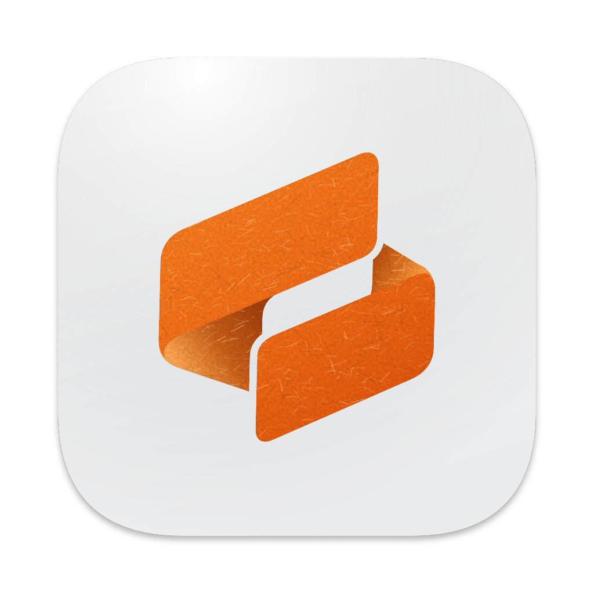
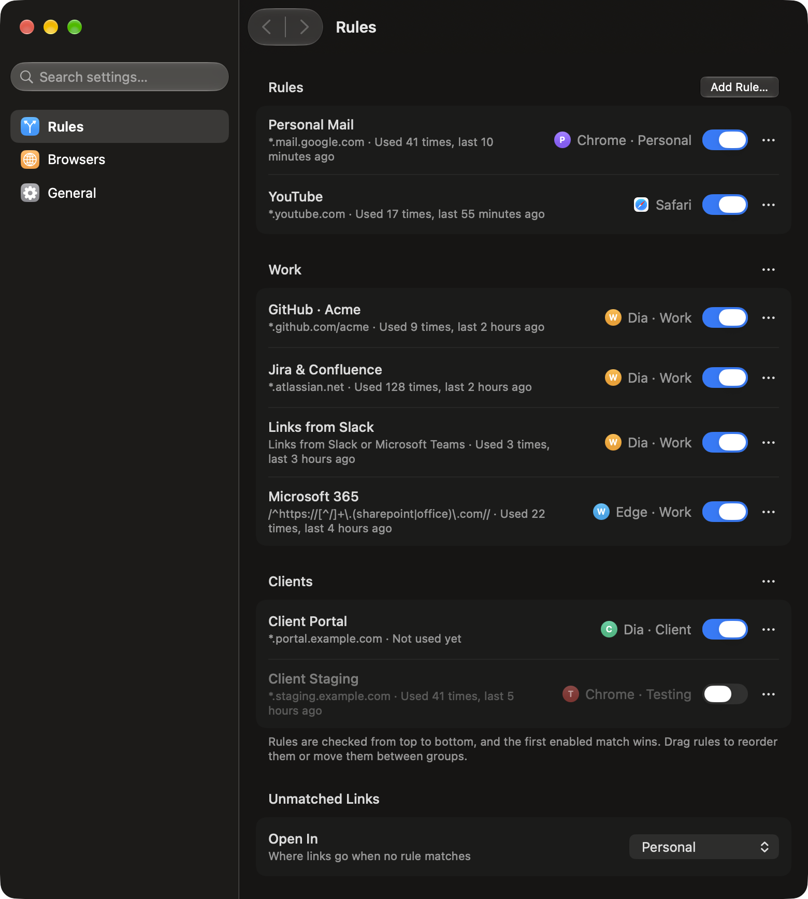
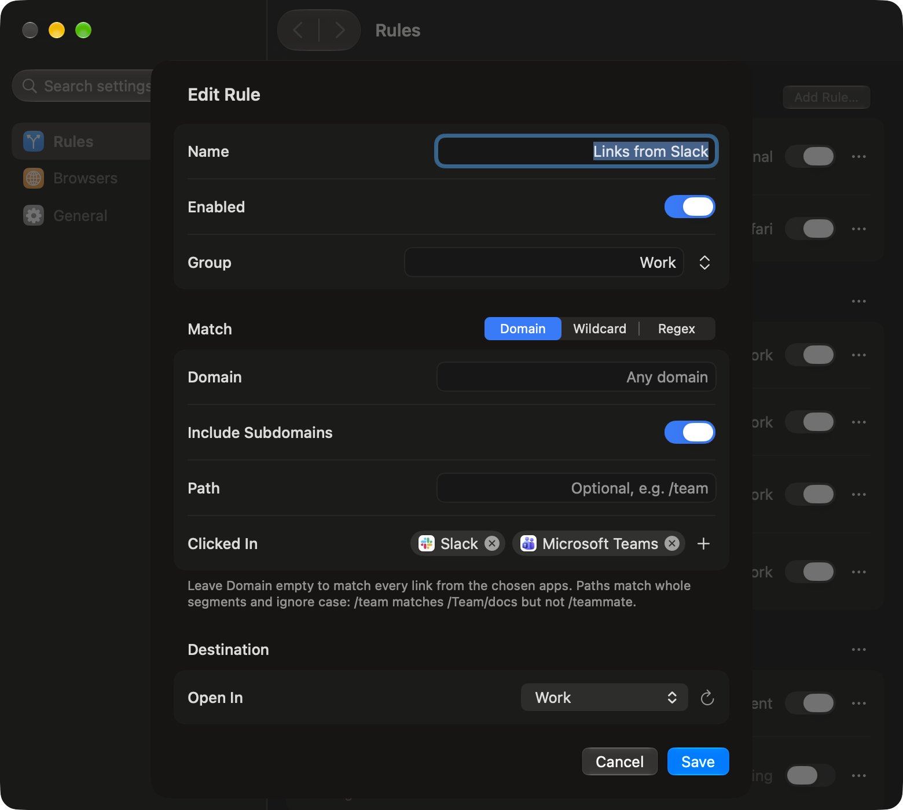
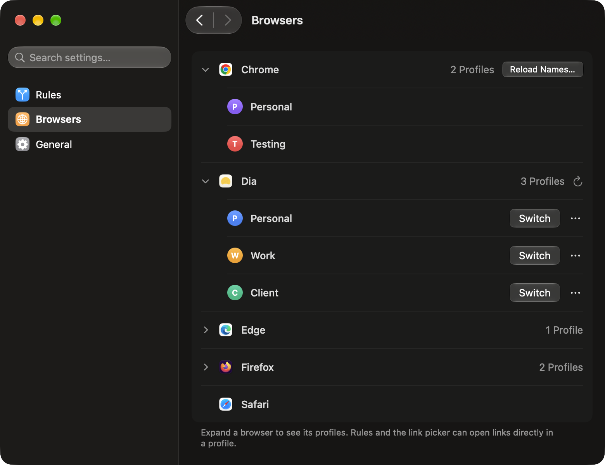
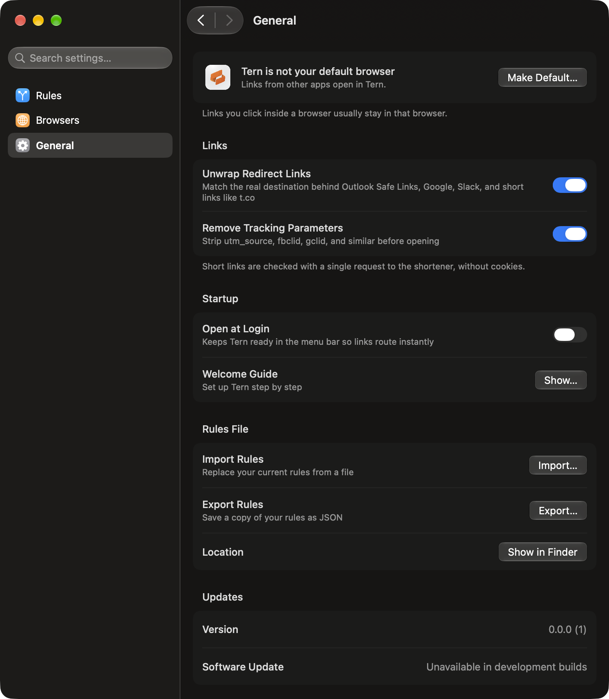

<p align="center"></p>
<h1 align="center">Tern</h1>
<p align="center"><strong>A home for every link.</strong></p>

Tern is a small macOS menu-bar app that becomes your default browser and sends every link to the right browser and profile. Clicked a GitHub link in Slack? It opens in your work profile. A YouTube link in Mail? Your personal browser. Everything else goes where it always went.

<p align="center"></p>

<table>
  <tr>
    <td width="33%"></td>
    <td width="33%"></td>
    <td width="33%"></td>
  </tr>
  <tr>
    <td align="center"><sub>Match by domain, wildcard, regex, or source app</sub></td>
    <td align="center"><sub>Profiles from Dia, Chromium, and Firefox browsers</sub></td>
    <td align="center"><sub>Link cleaning, startup, and rules file</sub></td>
  </tr>
</table>

## Highlights

- **Rules for any browser and profile.** Chrome, Edge, Brave, Vivaldi, Opera, Arc, Dia, Firefox, Zen, Safari, and more. Open a link in a specific profile wherever the browser supports it.
- **Flexible matching.** By domain and path, wildcard (`*.atlassian.net`), or regular expression. Optionally only for links clicked in certain apps, such as Slack, Teams, or Mail.
- **Cleaner links.** Matches the real destination behind Outlook Safe Links, Google, Slack, Facebook, LinkedIn, and Proofpoint redirects, and removes tracking parameters. Resolving short links like t.co and bit.ly is available as an opt-in.
- **Organized rules.** Groups, drag to reorder, enable or disable a whole group, and per-rule usage counts.
- **A link tester** that shows where a link would open, without opening it.
- **Your usual browser stays the fallback.** Links no rule matches open where they did before Tern, or ask you every time.
- **Local and private.** Routing happens entirely on your Mac. No accounts, no telemetry, no browsing history, and no Full Disk Access.

## Install

```sh
brew tap dominik-bura/tern
brew trust dominik-bura/tern   # Homebrew asks you to trust third-party taps once
brew install --cask dominik-bura/tern/tern
```

Or download the DMG from [Releases](https://github.com/dominik-bura/tern/releases). Tern isn't notarized, so approve it once in System Settings → Privacy & Security on first launch.

On first launch a short welcome guide helps you make Tern your default browser, choose where unmatched links go, add a first rule, and turn on Open at Login. You can reopen it anytime from General.

Requires macOS 14 or later.

## Using Tern

Tern lives in the menu bar: **New Rule…**, **Open Link from Clipboard**, **Make Tern Default Browser…** (only while it isn't), and **Open Tern…**. The window has three pages:

- **Rules** lists your rules in the order they're checked, in groups if you use them. Add, edit, toggle, and drag rules; use a rule's ⋯ menu or context menu for more. Below, choose where unmatched links open and test a link.
- **Browsers** lists every installed browser. Browsers with profiles expand to show them, with the profile's color or account picture.
- **General** makes Tern the default browser (and restores the previous one), controls link cleaning and Open at Login, imports or exports your rules as JSON, and controls software updates.

When a rule or the fallback is set to **Ask Every Time**, a picker appears: arrow keys and Return to choose, Escape to cancel, and an option to remember the choice as a rule.

## Browsers and profiles

| Browsers | Profiles | How Tern opens a profile |
| --- | --- | --- |
| Chrome, Edge, Brave, Vivaldi, Opera, Opera GX, Chromium, Thorium, Comet, Helium (including Beta/Dev/Canary channels) | Yes | `--profile-directory` |
| Firefox, Firefox Developer Edition, Nightly, Zen | Yes | `-P <profile>` |
| Dia | Yes | Creates the tab in the profile; can also switch the current window's profile |
| Safari, Arc, Orion, and any other browser | Browser only | These browsers offer no way to open a link in a chosen profile |

Profile lists are read from each browser's own files without launching it. Chrome, Edge, and Firefox keep these files private on recent macOS. Tern then shows the profile folders it can detect and asks you to select the list file once (**Show Profile Names → Select File…**). That grants access to that one file, and Tern remembers the names.

## How matching works

Rules are checked from top to bottom (ungrouped rules first, then each group), and the first enabled match wins.

- **Domain:** matches the host exactly or including subdomains, at a label boundary: `example.com` never matches `badexample.com`. An optional path matches whole segments and ignores case: `/team` matches `/Team/docs`, not `/teammate`.
- **Wildcard:** `*` matches anything. Without a `/` the pattern is checked against the host (`*.notion.so`), otherwise against host, path, and query (`*.atlassian.net/wiki/*`).
- **Regex:** tested against the whole link, ignoring case.
- **Clicked In:** limits a rule to links from certain apps. Tern reads the app that sent the link, falling back to the frontmost app. Leave the domain empty to match every link from those apps.

With **Unwrap Redirect Links** on, rules match the destination inside a redirect wrapper. This is done locally. Outlook Safe Links and Proofpoint links are matched by their destination but still opened through the wrapper, so your organization's click-time scan keeps working. **Remove Tracking Parameters** strips `utm_*`, `fbclid`, `gclid`, and similar. **Resolve Short Links** is off by default: when on, Tern asks the shortener (t.co, bit.ly, …) where a link points with one cookieless HTTPS `HEAD` request that doesn't follow the redirect. Use punycode for international hostnames.

Rules start empty: Tern never guesses which account a shared service like GitHub belongs to.

## Limits

Tern only sees links that macOS hands to the default browser, such as links clicked in other apps. Links clicked inside a browser stay there. Universal Links, sign-in windows, and apps that pick a browser themselves may bypass Tern. Quitting Tern doesn't change your default browser; macOS relaunches Tern for the next link.

Dia: profile names are matched exactly in the frontmost Dia window at delivery time; missing or duplicate names fail visibly instead of opening in the wrong account. If Dia has no window, Tern asks you to open one. A failed delivery stays queued until retried, redirected, or cancelled. Tern never changes Dia's settings.

## Privacy

Routing is local. Tern has no accounts, telemetry, URL logging, or browsing history, and never sends a link anywhere except to the browser you chose. It keeps only a count and last-used time per rule. Rules stay in Tern's Application Support folder. Pending links exist only in memory. The clipboard is read only when you choose Open Link from Clipboard.

Tern makes exactly two kinds of network requests:

- **Update checks** (release builds only): GitHub's release API on launch, every six hours, and on demand. No link or rule data is sent.
- **Short-link resolution**, only if you turn on Resolve Short Links: one `HEAD` request to the shortener of the link you clicked.

Profile names are read from browsers' own files, never by launching them. Tern never asks for Full Disk Access; for browsers that keep their files private, you pick the one file Tern may read. Browsers are opened with fixed, validated arguments, and Dia is controlled through a fixed script that receives links and profile names only as data.

## Updates

Production builds check GitHub on launch, every six hours, and on demand. The menu shows **Update Available…** or **Update Ready…**; General also shows update status. A native prompt offers **Update & Relaunch**, **Remind Tomorrow**, and **Skip Version**. Reminders and skipped versions survive restarts, and you can review an update explicitly from the menu at any time when Tern isn't handling links or an open dialog.

**Automatically Install Updates** is optional and off by default. When enabled, Tern downloads and verifies updates in the background, then waits for a continuous idle minute with no open Tern windows or menu interaction before restarting. Both manual and automatic installation wait for incoming-link resolution, queued links, browser delivery, the browser picker, rule editing, and open dialogs to finish. If work begins during a manual download, the update stays ready for another explicit approval. Turning automatic updates off keeps a prepared update available for manual installation. An update relaunch stays in the menu bar without reopening the configuration window or taking focus.

Downloads require SHA-256 verification, a production bundle identity, the exact expected newer version, matching repository, a valid code signature, and a matching signing team when the installed app has one. The helper revalidates before replacing the bundle and restores the previous app if relaunch fails. Ad-hoc releases have weaker publisher identity than Developer ID builds. Development builds cannot self-update.

## Build from source

```sh
git clone https://github.com/dominik-bura/tern.git
cd tern
swift test
./scripts/build-app.sh release
open "build/Tern Dev.app"
```

Swift tools 6.0+, Swift language mode 5, no third-party dependencies. `release` selects optimization; the channel remains development unless explicitly changed. Bundled builds support URL registration, artwork, and Automation consent. A bare executable is not the supported routing installation.

For a direct external-link test without changing system defaults:

```sh
open -a "$PWD/build/Tern Dev.app" 'https://example.com'
```

Generate artwork from the editable SVG masters in `assets/vector/` with `swift scripts/generate-icon-assets.swift`. Regeneration requires librsvg (`brew install librsvg`); regular app builds use the generated assets and need no extra renderer. See [releasing](docs/releasing.md), [manual testing](docs/manual-test-plan.md), and the [implementation specification](docs/implementation-plan.md).

## Contributing

[Open an issue](https://github.com/dominik-bura/tern/issues) with your macOS and browser versions and the expected routing behavior. Avoid including private URLs or tokens. Run the deterministic tests and bundle verification before proposing changes. Live browser tests are opt-in and must use disposable tabs.
